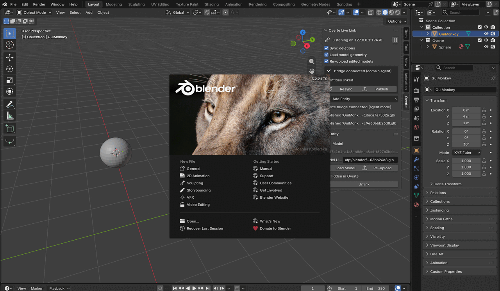

# OverteInAShell

**Overte Live Link**: use Blender as the scene editor for an
[Overte](https://overte.org) domain. Move, scale, add, duplicate and delete
entities in Blender and they change in-world, live; edits made in Overte show
up in Blender. Publish any Blender mesh as a Model entity in one click.



## How it works

```
Blender + add-on                              Overte domain
┌─────────────────────────────┐  WebSocket  ┌──────────────────────────────────┐
│ Link server (port 9420)     │◄────────────│ overte_bridge.js                 │
│  · serves the bridge script │─── HTTP ───►│  domain Persistent Script (agent)│
│  · scene ⇄ entity sync      │             │  or an Interface client script   │
└─────────────────────────────┘             └──────────────────────────────────┘
```

The add-on runs a small WebSocket + HTTP server inside Blender. The bridge
script runs inside Overte, connects out to Blender, streams entity changes and
applies Blender's edits through the normal `Entities` API, so permissions,
locks and other people in the domain behave exactly as they do in-world.

## Install

Requires **Blender 4.2 or newer** (tested on 5.2 LTS) and an Overte domain
(tested with Overte 2026.04.1).

1. Get `overte_live_link-<version>.zip`: build it with
   `python3 scripts/build_extension.py` (it lands in `dist/`), or download the
   `overte-live-link` artifact from a CI run.
2. In Blender: *Edit → Preferences → Get Extensions → ⌄ → Install from Disk…*
   and pick the zip.

## Use

1. In the 3D Viewport press **N**, open the **Overte** tab and click
   **Start Live Link**.
2. Run the bridge in Overte. Copy its URL with the copy button in the panel:
   it looks like `http://127.0.0.1:9420/overte_bridge.js?token=…`.
   * **As a domain Persistent Script** (recommended; always on, full rights):
     domain settings (`http://<domain>:40100`) → *Content → Scripts →
     Persistent Scripts* → add the URL.
     If the domain runs on another machine, set *Listen address* to `0.0.0.0`
     before starting, and use this computer's address in the URL. The domain
     must be able to reach it.
   * **In Interface**, with your own permissions: *Edit → Running Scripts →
     From URL* and paste the URL.
   * Or **Save Bridge Script…** and host the file yourself (for example on
     the domain's asset server).
3. The domain's entities appear in Blender's **Overte** collection. Edit away.

The token in the URL is saved with your .blend, so the persistent-script URL
keeps working across sessions. **New Access Token** revokes it.

### What syncs

| Overte | Blender | Direction |
|---|---|---|
| position, rotation, dimensions | object transform (scale = size) | both |
| parent | parent | both |
| name | object name | both |
| color (Box, Sphere, Shape) | object material colour | both |
| Light: color, intensity, falloff radius, spot cutoff/exponent | light data (100 W = intensity 1) | both |
| visible | render visibility (camera icon) | both |
| locked | location/rotation/scale locks | both |
| create / delete | *Add → Overte Entity* (or the panel) / delete | both |
| Shift+D duplicate | clones the entity with all its properties | Blender → Overte |
| Model entity | its real geometry, from `atp:` or `http(s):` | both |

* Box, Sphere and Shape entities appear as unit meshes; lights as lights;
  Model entities as their geometry (`.glb`, `.gltf`, `.fbx`, `.obj`; each
  model is loaded once and shared by every entity using it). Other types
  (Zone, Text, Image, Web, …) appear as cube empties sized to their
  dimensions.
* Overte draws Box, Sphere and Shape entities itself, so editing their mesh
  in Blender changes nothing in Overte (and, as they share one mesh, changes
  every primitive of that shape in Blender). Use **Convert to Model** to edit
  one's mesh.
* Properties the add-on doesn't map (scripts, userData, zone settings,
  physics, …) are left untouched in Overte.
* Changes merge per field: if you move an entity in Blender while someone
  recolours it in Overte, both changes survive.

### Publishing your own meshes

Select meshes (curves and text work too) and choose **Object → Publish to
Overte**, or click **Publish** in the panel. Each one is exported with
modifiers applied and materials and textures embedded, then uploaded to the
domain's asset server as `atp:/blender/<name>-<hash>.glb`. It becomes a Model
entity exactly where the object is. The object's origin can be anywhere; the
entity is fitted to the mesh's bounding box.

Edit the mesh later and, when you leave Edit Mode, the new version is
uploaded and the entity switches to it. Turn off *Re-upload edited models* to
do this by hand with **Re-upload**. Uploading needs asset-server write
permission, which a domain Persistent Script always has.

Selected lights are published as Light entities.

To give a Box, Sphere or Shape entity your own geometry, select it and click
**Convert to Model** in the panel's *Entity* section. Its mesh is published
as a Model entity in the same place (with its colour and children), and the
original entity is deleted once the new one exists. Then edit the mesh like
any published one.

### Things to know

* **Deleting in Blender deletes in Overte** (turn off *Sync deletions* to
  prevent it). Opening another .blend file stops the link first, so nothing
  is deleted by accident.
* **Switching .blend files.** Each .blend has its own access token, so a
  bridge started with one file's URL can't connect to another file's link.
  To link a different file, stop the old bridge (Interface: *Edit → Running
  Scripts*, stop `overte_bridge.js`; domain: remove it from *Persistent
  Scripts*) and run the new file's URL instead. Only one Blender at a time
  can listen on a port.
* **Undoing a deletion** brings the object back, but its entity is gone; the
  panel lists such objects with **Recreate in Overte**.
* **Entities deleted in Overte** disappear from Blender after about 4 s. An
  Overte agent can briefly lose sight of an entity right after it is edited,
  and the delay keeps that from looking like a deletion.
* **In Interface mode** the bridge only sees entities your client has loaded.
* **Scaling a parent** in Blender also changes its children's sizes in
  Overte, where children don't inherit scale, so both stay visually identical.

## Layout

| Path | What it is |
|---|---|
| `overte_live_link/` | The Blender extension |
| `overte_live_link/bridge/overte_bridge.js` | The script that runs inside Overte |
| `overte_live_link/scene_sync.py` | Scene ⇄ entity sync (per-field three-way merge, change tracking) |
| `overte_live_link/models.py` | Mesh publishing and model geometry loading |
| `overte_live_link/session.py` | Server, access token, bridge selection, request routing (no `bpy`) |
| `overte_live_link/wsserver.py` | Dependency-free WebSocket + HTTP server |
| `overte_live_link/convert.py` | Blender (Z-up) ⇄ Overte (Y-up) conversion |
| `docs/PROTOCOL.md` | The Blender ⇄ bridge message protocol |
| `scripts/run_local_domain.sh` | Start/stop a throwaway local Overte domain |
| `scripts/build_extension.py` | Build the installable zip |
| `tests/` | Unit tests, end-to-end tests against a real domain, and a GUI test in real Blender |

## Development

```bash
pip install -r requirements-dev.txt   # bpy from PyPI = headless Blender for tests
pytest -q -m "not overte"             # unit tests
pytest -q -m overte                   # end-to-end, needs the Overte server in /opt/overte
```

The end-to-end tests start a fresh local domain running the bridge and an
independent *probe* agent, which checks what the entity server really holds
and plays "another user". Get the server from
https://public.overte.org/build/overte/release/ (`overte-server_*.deb`).

```bash
scripts/run_local_domain.sh start http://127.0.0.1:9420/overte_bridge.js?token=…
scripts/run_local_domain.sh status
scripts/run_local_domain.sh stop
```

`tests/gui_e2e.py` runs the same kind of scenario inside the real Blender app
(CI runs it under Xvfb), where Blender's own timers and handlers drive the link.

CI runs three jobs: unit tests, end-to-end tests against Overte, and the
Blender GUI test, which also validates and installs the built extension.
